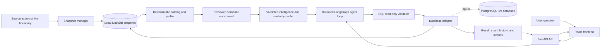

# Queris

**A local, safe, and auditable database-discovery layer for natural-language analytics.**

[](https://github.com/nevetsagetro/Queris/actions/workflows/quality.yml)
[](https://www.python.org/)
[](LICENSE)

Queris helps a team understand a database before asking it questions. It imports a local snapshot,
builds a deterministic catalog, enriches it with reviewed semantic metadata, prepares validated
analysis starters, and converts natural language into read-only SQL.

The LLM can interpret metadata and propose SQL. It never receives unrestricted database access and
never executes SQL. A database adapter validates and executes every statement in read-only mode.

## What Queris provides

- **Snapshot-first discovery:** import CSV, Parquet, ZIP, SQLite, or DuckDB sources into a local
  workspace without modifying the source database.
- **Useful catalog:** tables, columns, types, bounded samples, row statistics, relationships,
  cardinality hints, provenance, and schema fingerprints.
- **Prepared intelligence:** 50–60 validated question starters per sufficiently rich dataset,
  including SQL, rationale, result metadata, and chart recommendations.
- **Safe text-to-SQL:** schema-aware generation, SQL policy validation, bounded correction, and
  read-only execution.
- **No unnecessary LLM calls:** prepared demos, replayed SQL, local similarity matches, and repeat
  questions use deterministic cache paths.
- **Reviewable frontend:** Ask, Data catalog, and History views show execution flow, SQL, sources,
  charts, metrics, demo history, and real analyses.
- **Optional live mode:** PostgreSQL can be enabled explicitly through a read-only adapter. Local
  snapshot mode remains the default and the reproducible path.

## Product flow

```text
source export
    ↓
local snapshot and provenance
    ↓
deterministic catalog and profile
    ↓
reviewed semantic enrichment
    ↓
validated query intelligence and similarity cache
    ↓
generate → validate → execute read-only → explain → cache
```

The workspace keeps generated intelligence and cache metadata outside business tables:

```text
.queris/manifest.yaml       dataset identity and provenance
raw/                         original downloaded or copied artifacts
snapshots/                   derived local DuckDB files
catalog/                     schema and profile reports
intelligence/               validated query starters
cache/                      enrichment, refresh, invalidation, and metrics artifacts
```

## Architecture



The LLM participates in semantic interpretation and SQL generation only. The adapter remains the
authority for schema access, SQL validation, read-only execution, and runtime boundaries.

## Quick start

Requirements: Python 3.11+ and, for the React frontend, Node.js 18+.

```bash
git clone https://github.com/nevetsagetro/Queris.git
cd Queris
python -m venv .venv
source .venv/bin/activate
python -m pip install -e '.[dev]'
```

Create the deterministic local fixture and start the API:

```bash
queris-sample-data data/retail.duckdb
QUERIS_DATABASE=data/retail.duckdb queris-api
```

The API is available at `http://127.0.0.1:8000`. Check it with:

```bash
curl http://127.0.0.1:8000/health
curl http://127.0.0.1:8000/runtime
```

### Clone-to-check

The first verification path is credential-independent and does not require a live database or an
LLM key:

```bash
python -m pip install -e '.[dev]'
queris-ci-eval
```

For the full local suite, run `python -m pytest`. A provider key is only needed for provider-backed
generation or the live demo evaluation.

## React frontend

The primary frontend is in [`frontend/`](frontend/). It connects to the FastAPI boundary; the
browser never opens the database or executes SQL.

```bash
cd frontend
npm install
VITE_API_URL=http://127.0.0.1:8000 npm run dev
```

Open the Vite URL shown in the terminal, normally `http://localhost:5173`.

The interface includes:

- **Ask:** question input, execution flow, answer, SQL, sources, explanation, and chart.
- **Data catalog:** active dataset provenance, schema, profiles, relationships, and starters.
- **History:** prepared demo history, recommended runs, real analyses, replay cache, and workspace
  metrics.

If port `8000` is already used by another service, start Queris on another port and pass the same
URL to Vite:

```bash
QUERIS_PORT=8002 QUERIS_DATABASE=data/retail.duckdb queris-api
VITE_API_URL=http://127.0.0.1:8002 npm run dev
```

The packaged `queris-demo` Streamlit command remains available for legacy evaluation and
compatibility workflows. It is not the primary product interface; new frontend work belongs in the
React application.

### Start with a public dataset

The frontend does not download or execute database files in the browser. Use the setup CLI to
download a public source, preserve it under ignored local storage, materialize a DuckDB snapshot,
and then point the API at that snapshot:

```bash
queris-dataset chinook
QUERIS_DATABASE=data/chinook.duckdb \
QUERIS_DATABASE_DIR=data \
queris-api
```

For larger relational analysis, use the public Olist dataset instead:

```bash
queris-dataset olist
QUERIS_DATABASE=data/olist.duckdb \
QUERIS_DATABASE_DIR=data \
queris-api
```

Open the React frontend after starting the API. The dataset selector, catalog, source metadata,
prepared history, and recommendations are then populated from the local snapshot. Source URLs and
licenses are documented in [`docs/additional-datasets.md`](docs/additional-datasets.md).

## Snapshot workflow

For a new database, use an isolated workspace rather than connecting the LLM directly to a remote
system:

```bash
queris-snapshot init workspaces/customer-db
queris-snapshot import https://example.org/export.parquet \
  --workspace workspaces/customer-db \
  --dataset-id customer-db \
  --name "Customer database" \
  --source-name "Public publisher" \
  --source-url "https://example.org/export.parquet" \
  --license "Publisher terms"

queris-discover --workspace workspaces/customer-db --dataset-id customer-db
queris-enrichment workspaces/customer-db/snapshots/customer-db.duckdb --dry-run
queris-intelligence workspaces/customer-db/snapshots/customer-db.duckdb \
  --output workspaces/customer-db/intelligence/customer-db.queries.json
```

Refresh is explicit and supports dry-run planning before writing artifacts:

```bash
queris-refresh --workspace workspaces/customer-db \
  --dataset-id customer-db --dry-run
```

Schema drift invalidates only affected starters and cache entries. Unaffected validated starters
are retained with the new schema fingerprint.

For the registered public demo datasets, see [`docs/additional-datasets.md`](docs/additional-datasets.md)
and [`docs/online-retail-demo.md`](docs/online-retail-demo.md).

## API surface

| Endpoint | Purpose |
|---|---|
| `GET /health` | Database or adapter availability |
| `GET /runtime` | Explicit `snapshot`/`live` mode and read-only status |
| `GET /datasets` | Public-source datasets available to the frontend |
| `GET /catalog` | Discovered schema |
| `GET /catalog/profile` | Bounded table and column profile |
| `GET /history/demo` | Prepared dataset-specific starters |
| `GET /metrics` | Local privacy-preserving execution metrics |
| `POST /query` | Generate, validate, execute, and explain a question |
| `POST /query/replay` | Re-execute saved read-only SQL without an LLM |

Example:

```bash
curl -X POST http://127.0.0.1:8000/query \
  -H 'Content-Type: application/json' \
  -d '{"question":"How many orders are there?"}'
```

## Optional PostgreSQL live mode

Live mode is opt-in. Credentials stay in the environment boundary and are never written to
manifests, prompts, logs, or frontend responses.

```bash
python -m pip install -e '.[postgres]'
export QUERIS_RUNTIME_MODE=live
export QUERIS_POSTGRES_DSN='postgresql://...'
export QUERIS_STATEMENT_TIMEOUT_MS=30000
queris-api
```

The PostgreSQL adapter enforces a read-only session, validates statements, applies a bounded
statement timeout, and supports an optional bounded pool. The same generation and validation flow
is used for live execution; snapshot mode remains the recommended path for discovery and repeatable
analysis.

## Safety model

Queris treats model output and database content as untrusted:

1. Only one SQL statement is accepted.
2. The SQL policy allows only documented read-only query shapes.
3. Mutations, DDL, filesystem readers, extension operations, pragmas, dynamic queries, and stacked
   statements are rejected before execution.
4. DuckDB snapshots open with `read_only=True`; live engines use an adapter-enforced read-only
   session.
5. Prompt-like text stored in rows remains data, never instructions.
6. Correction retries are bounded and terminal results are typed.
7. Structured logs exclude questions, SQL, rows, database paths, credentials, and sensitive errors.

## Validation

Run the complete local quality gate:

```bash
python -m pytest
python -m ruff check .
python -m ruff format --check .
pre-commit run --all-files
```

The repository includes deterministic baseline, adversarial, demo, retrieval, API, container, and
credential-independent CI evaluations. Generated databases, reports, credentials, and local
metrics are ignored and do not belong in Git.

## Architecture decisions and roadmap

Important decisions are recorded in [`docs/adr/`](docs/adr/). The current product roadmap is
[`docs/queris-local-discovery-roadmap.md`](docs/queris-local-discovery-roadmap.md).

The project deliberately prioritizes a safe local discovery layer before adding more remote
connectors. BigQuery, Snowflake, and MySQL remain future connector work until they meet the same
adapter, dialect-validation, timeout, credential, and integration-test contract as PostgreSQL.

## Repository map

```text
src/queris/             application, adapters, safety, discovery, agent, API, and evaluation
frontend/               React/TypeScript product interface
tests/                  deterministic unit and integration tests
evals/                  versioned questions and adversarial cases
metadata/               reviewed schema enrichment
docs/adr/               architectural decision records
skills/                 repeatable contributor workflows
.github/workflows/      quality, evaluation, and container checks
```

## License

See the repository license and individual dataset source terms before redistributing imported
snapshots.
