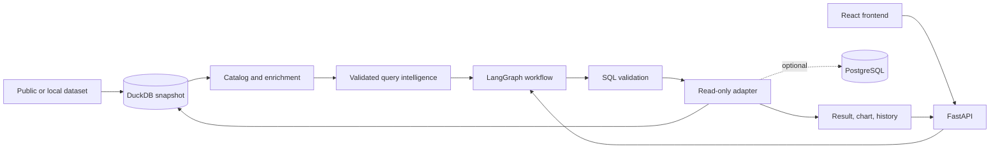

# Queris

### From a database snapshot to trustworthy answers.

[](#evidence)
[](#evidence)
[](#evidence)
[](https://www.python.org/)
[](LICENSE)

Queris is a local database-discovery and text-to-SQL workspace for teams that need to understand
data before relying on an answer.

It turns a public or local dataset into:

```text
catalog → useful questions → validated SQL → result, chart, and explanation
```

The experience is built with **React + Vite**, backed by **FastAPI**, with a **LangGraph** execution
flow and read-only database adapters.

## See the product in five minutes

### 1. Install and download a real public database

```bash
git clone https://github.com/nevetsagetro/Queris.git
cd Queris
python -m venv .venv && source .venv/bin/activate
python -m pip install -e '.[dev]'
queris-dataset chinook
```

Chinook is a small public relational dataset. For a larger commerce example, use
`queris-dataset olist` instead.

### 2. Start the API

```bash
QUERIS_DATABASE=data/chinook.duckdb \
QUERIS_DATABASE_DIR=data \
queris-api
```

### 3. Start React

In a second terminal:

```bash
cd frontend
npm install
VITE_API_URL=http://127.0.0.1:8000 npm run dev
```

Open the Vite URL, normally [http://localhost:5173](http://localhost:5173).

## What to evaluate

In the UI, review the complete workflow:

1. **Data catalog** — tables, columns, profiles, relationships, provenance, and schema status.
2. **Question starters** — prepared dataset-specific analyses with SQL and chart recommendations.
3. **Ask** — natural language translated into read-only SQL.
4. **Execution flow** — catalog, generation, validation, execution, and cache state.
5. **History** — saved SQL, repeatable results, explanations, sources, and metrics.

## Architecture



The LLM proposes SQL; it does not connect to or execute against the database. The adapter is the
execution boundary.

## Evidence

The repository includes a credential-independent regression gate:

```bash
queris-ci-eval
```

It verifies:

| Gate | Result |
|---|---:|
| Deterministic result cases | 50/50 |
| Unsafe-query cases blocked | 24/24 |
| Adversarial cases passed | 27/27 |

For the complete local suite:

```bash
python -m pytest
python -m ruff check .
python -m ruff format --check .
pre-commit run --all-files
```

## Why it is safe to review

- Database files are handled locally and remain read-only at runtime.
- Generated SQL is parsed and rejected when it violates the SQL policy.
- Repeat questions and saved analyses use local cache/replay paths instead of unnecessary LLM calls.
- Credentials, SQL, rows, and database paths are excluded from structured logs and frontend state.

## Explore further

- [Frontend guide](frontend/README.md)
- [Public datasets and provenance](docs/additional-datasets.md)
- [Online Retail demo](docs/online-retail-demo.md)
- [Discovery roadmap](docs/queris-local-discovery-roadmap.md)
- [Architecture decisions](docs/adr/)
- [Contributor guide](CONTRIBUTING.md)

## Optional live mode

Snapshot mode is the default. PostgreSQL live mode is opt-in through a read-only adapter and an
environment credential boundary. See [ADR 0013](docs/adr/0013-use-explicit-live-adapter-mode.md).

## License

See [LICENSE](LICENSE) and the source terms for each downloaded dataset.
