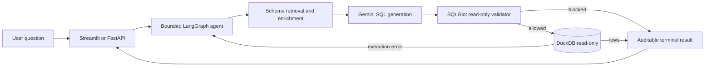

# Queris

**A safety-first, evaluated Text-to-SQL analytics agent.**

Queris turns natural-language business questions into validated, read-only SQL over DuckDB. It is
more than an LLM wrapper: schema retrieval, bounded self-correction, adversarial testing, transparent
execution metrics, and automated regression gates are part of the product.

The original portfolio scope is complete through productionization. The roadmap now defines a
second tier of reasoning and generalization work beyond that accepted baseline.

## Why this project stands out

- **Safety is enforced in code.** SQLGlot parses every generated statement before execution, and
  DuckDB is opened in read-only mode as defense in depth.
- **Evaluation is a first-class feature.** Versioned accuracy, unsafe-query, prompt-injection,
  ambiguity, unanswerable-question, and wide-schema collision cases run in CI.
- **The agent can recover.** A bounded LangGraph loop feeds syntax or execution errors back into
  generation and retries at most three times.
- **The result is explainable.** The demo shows SQL, rows, charts, explanations, schema sources,
  retries, latency, and blocked status.
- **It is packaged for deployment.** FastAPI, Pydantic contracts, Docker Compose, structured JSON logs, and
  GitHub Actions are included.

## Verified results

| Evaluation | Result | What it demonstrates |
|---|---:|---|
| Phase 6 deterministic result gate | 50/50 | Expected SQL still executes and returns the reviewed result |
| Unsafe-query policy suite | 24/24 blocked | Reviewed filesystem, extension, mutation, and stacked-query attacks are rejected |
| Phase 7 adversarial suite | 27/27 | Safety and documented ambiguity, no-answer, metadata, and retrieval behavior |
| Live Streamlit demo evaluation | 5/5 | Correct results and explanations with `gemini-3.5-flash`, with zero retries |
| Enriched wide-schema retrieval | 1.00 recall@5 | Reviewed metadata recovers every labeled relevant column |
| Automated Python suite | 280 tests | Unit, integration, safety, evaluation, API, CI, and container configuration coverage |

The evaluation questions, expected SQL, and reviewed results were created together during
development and were not independently reviewed against a hidden answer key. These numbers verify
the versioned regression contract, not generalization to unseen schemas; Phase 14 adds a cold
held-out evaluation and publishes the performance delta.

The CI gate is credential-independent: it creates disposable fixtures, uses reviewed reference SQL
for result regression, runs adversarial cases through the real validation paths, and fails if a case
set is reduced or any required rate falls below 100%.

See [concrete evaluation transcripts](docs/examples.md) for a blocked prompt-injection attempt, a
self-corrected execution failure, and a typed no-answer response.

## Architecture



The runtime never exposes a general-purpose database or system-command tool to the model.
Generation currently uses a single prompt pass with retrieved schema context. The roadmap adds
semantic critique, bounded schema-discovery tools, confidence estimation, and multi-step planning
without weakening the existing validation boundary.

### Design trade-offs at scale

The current local architecture favors auditable behavior over warehouse-scale throughput. At 100+
tables, retrieval would need measured recall across domains and likely hierarchical or
catalog-assisted routing rather than a single top-k search. Concurrent production traffic would
also require pooled, workload-limited database connections instead of opening a local DuckDB file
per request. Schema embeddings would need an explicit refresh and invalidation policy as tables,
columns, and reviewed metadata drift.

## Try the demo

Requirements: Python 3.11+ and a Gemini API key.

```bash
git clone https://github.com/nevetsagetro/Queris.git
cd Queris
python -m venv .venv
source .venv/bin/activate
python -m pip install -e '.[dev]'
export GEMINI_API_KEY=...
queris-sample-data data/retail.duckdb
queris-demo
```

Open the displayed Streamlit URL and ask:

> Which product categories have negative total gross profit?

The demo is organized into `Ask`, `Data catalog`, and `History` tabs. It shows the execution flow
from question to schema inspection, SQL generation, read-only validation, execution, and
presentation. Repeated questions reuse an in-memory session cache while the DuckDB file is
unchanged; the result table, chart, explanation, validated SQL, referenced schema sources, retry
count, latency, blocked status, and session history remain available for review.

For a larger local demo source with realistic prices, customers, countries, and time series, run
`queris-online-retail data/online_retail.duckdb`, then start `queris-demo`. The demo prefers the
larger database when it exists. The command downloads the UCI Online Retail workbook into ignored
local storage and normalizes it for Queris. See
[`docs/online-retail-demo.md`](docs/online-retail-demo.md) for ready-to-use questions and source
attribution. The deterministic `retail.duckdb` fixture remains the test and CI database.

## React frontend

The React/TypeScript frontend lives under [`frontend/`](frontend/). It exposes the 100 curated
question starters, a local dataset selector, catalog profiles and relationships, recommended runs,
session history, chart recommendations, language similarity hints, and the safe FastAPI query
boundary. Start the API with `QUERIS_DATABASE=data/online_retail.duckdb QUERIS_DATABASE_DIR=data
queris-api`, then follow
[`frontend/README.md`](frontend/README.md).

The local dataset folder can contain multiple ignored DuckDB files. The setup commands below add
two structurally different public examples for review:

```bash
queris-dataset chinook
queris-dataset olist
queris-dataset penguins
```

See [`docs/additional-datasets.md`](docs/additional-datasets.md) for provenance and the
read-only conversion boundary.

### Add another dataset

An existing DuckDB file can join the same catalog workflow without editing application code:

```bash
queris-dataset-workflow data/example.duckdb \
  --dataset-name "Example Dataset" \
  --source-name "Public publisher" \
  --source-url "https://example.org/dataset" \
  --license "Publisher terms" \
  --draft metadata/example.v1.yaml \
  --report reports/example.workflow.json
```

The command records public provenance, profiles tables and probable relationships, drafts reviewed
catalog metadata, generates and executes deterministic starters, and reports whether the dataset
is ready. Review the YAML and change `reviewed` to `true` before re-running. No command in this
workflow writes to the DuckDB file; runtime connections remain read-only.

## Run the API

```bash
export GEMINI_API_KEY=...
queris-sample-data data/retail.duckdb
queris-api
```

Then query it:

```bash
curl http://127.0.0.1:8000/health

curl -X POST http://127.0.0.1:8000/query \
  -H 'Content-Type: application/json' \
  -d '{"question":"How many orders are there?"}'
```

`POST /query` returns a typed terminal result containing SQL, rows, schema sources, retries, latency,
blocked state, and any clarification or no-answer response. Every handled HTTP response includes
an `X-Request-ID`.

The API emits privacy-preserving JSON completion logs with request ID, HTTP and agent latency,
retry count, and a bounded query decision. Questions, SQL, rows, database paths, error details, and
credentials are deliberately excluded.

## Run with Docker

```bash
queris-sample-data data/retail.duckdb
export GEMINI_API_KEY=...
docker compose up --build
```

The container runs as an unprivileged user, publishes port `8000`, and mounts the host DuckDB file
read-only. Set `QUERIS_DATABASE_PATH` to use another host fixture. Pull-request CI builds the image,
starts Compose, waits for the health check, verifies the API, and always tears the service down.

## Safety model

Queris treats model output and database content as untrusted:

1. Only one SQL statement is accepted.
2. Only explicitly allowed read-only query shapes pass.
3. Mutations, DDL, filesystem readers, extension operations, pragmas, dynamic queries, and stacked
   statements are rejected before database execution.
4. DuckDB connections used by the agent are opened with `read_only=True`.
5. Prompt-like text stored in rows remains data; it never becomes an instruction.
6. Retry count is bounded, and blocked or exhausted attempts return typed terminal results.
7. Query sources and operational metrics remain auditable without leaking sensitive content into
   service logs.

## Limitations and known risks

The evaluation questions and reviewed expectations were authored by the same person who built the
system; there is no independently authored held-out set yet. Phase 14 is planned to measure cold
generalization on a structurally different schema and publish the result.

SQLGlot validation covers the documented bypass classes, including comments, casing, nesting, and
stacked statements, but it has not been tested against an exhaustive or automated adversarial
search. The retail and wide-schema datasets are synthetic, so behavior against a messy production
warehouse schema remains untested. Confidence is also implicit today: the agent returns a result or
a typed clarification, no-answer, or blocked/failure response, but no calibrated score. Phase 11
plans agreement-based confidence and a distinct low-confidence path.

## Evaluation commands

```bash
# Credential-independent CI gate: 50 result + 24 policy + 27 adversarial cases
queris-ci-eval

# Full provider-backed report with local history
queris-sample-data data/retail.duckdb
queris-wide-data data/wide.duckdb
queris-evaluation-report data/retail.duckdb

# Reproduce the enriched wide-schema retrieval result with the fixture created above
queris-retrieval-eval data/wide.duckdb metadata/wide-schema.v1.yaml \
  evals/wide_schema_retrieval.json --top-k 5

# Strict five-question live demo evaluation
queris-demo-eval data/retail.duckdb
```

Generated databases and reports are ignored. Evaluation definitions, reviewed expectations, and
enrichment metadata are versioned.

## Technology

| Area | Choice |
|---|---|
| Analytics database | DuckDB |
| SQL policy | SQLGlot |
| Agent orchestration | LangGraph |
| LLM and embeddings | Google Gemini |
| Schema retrieval | DuckDB VSS plus deterministic offline evaluation |
| API contracts | FastAPI and Pydantic |
| Demo | Streamlit |
| Delivery | Docker Compose and GitHub Actions |
| Quality | pytest, Ruff, pre-commit, versioned evaluation gates |

## Repository map

```text
src/queris/       application, safety, retrieval, agent, API, and evaluation modules
tests/            deterministic unit and integration tests
evals/            versioned questions and adversarial cases
metadata/         reviewed schema enrichment
docs/adr/         architectural decision records
skills/           repeatable contributor workflows
.github/workflows pull-request quality, evaluation, and container checks
```

## Engineering decisions

Important choices are documented rather than hidden in implementation:

- [Reviewed, versioned schema enrichment](docs/adr/0004-use-versioned-reviewed-schema-enrichment.md)
- [DuckDB VSS for local schema vectors](docs/adr/0006-use-duckdb-vss-for-schema-vectors.md)
- [LangGraph for the bounded agent loop](docs/adr/0007-use-langgraph-for-agent-loop.md)
- [Versioned JSON evaluation sets](docs/adr/0008-use-versioned-json-evaluation-sets.md)
- [Versioned adversarial cases](docs/adr/0010-use-versioned-adversarial-evaluation-cases.md)

See [`roadmap.md`](roadmap.md) for the completed delivery history and [`CONTRIBUTING.md`](CONTRIBUTING.md)
for the review workflow.
