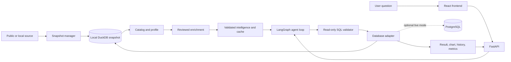

# Queris

**A local, safe, and auditable database-discovery layer for natural-language analytics.**

[](https://github.com/nevetsagetro/Queris/actions/workflows/quality.yml)
[](https://www.python.org/)
[](LICENSE)

Queris turns a public or local database snapshot into a discoverable, reviewable analytics
workspace. It builds a catalog, prepares validated questions, generates read-only SQL, explains the
result, and caches repeat work.

The LLM proposes SQL and interprets metadata. It never connects directly to a database or executes
SQL. FastAPI and a read-only adapter enforce the execution boundary.

## See it quickly

### 1. Install and download a real public dataset

```bash
git clone https://github.com/nevetsagetro/Queris.git
cd Queris
python -m venv .venv
source .venv/bin/activate
python -m pip install -e '.[dev]'
queris-dataset chinook
```

Chinook is a small public relational database and is ideal for a first review. For a larger
multi-table commerce dataset, replace it with:

```bash
queris-dataset olist
```

Sources and licenses are documented in [`docs/additional-datasets.md`](docs/additional-datasets.md).

### 2. Start the API

```bash
QUERIS_DATABASE=data/chinook.duckdb \
QUERIS_DATABASE_DIR=data \
queris-api
```

Verify the service:

```bash
curl http://127.0.0.1:8000/health
curl http://127.0.0.1:8000/runtime
```

### 3. Start the React frontend

In another terminal:

```bash
cd frontend
npm install
VITE_API_URL=http://127.0.0.1:8000 npm run dev
```

Open the Vite URL, normally [http://localhost:5173](http://localhost:5173).

The current product interface is React + Vite. Streamlit remains only as a legacy evaluation and
compatibility command; new frontend work belongs in [`frontend/`](frontend/).

## Architecture



## What a reviewer can inspect

- **Discovery:** schema, profiles, probable relationships, cardinality, provenance, and schema
  fingerprints in the Data catalog.
- **Intelligence:** 50–60 validated question starters with SQL, rationale, result metadata, and
  chart recommendations.
- **Execution:** catalog → generation → validation → read-only execution → cache, visible in the
  React interface.
- **Safety:** SQL policy validation, bounded correction, read-only DuckDB, optional read-only
  PostgreSQL sessions, and privacy-preserving logs.
- **Reproducibility:** saved SQL can be replayed without calling the LLM again.

## Technical verification

The first check is credential-independent and requires no LLM key or remote database:

```bash
queris-ci-eval
```

Run the full local suite as well:

```bash
python -m pytest
python -m ruff check .
python -m ruff format --check .
pre-commit run --all-files
```

The CI evaluation covers 50 deterministic result cases, 24 unsafe-query cases, and 27
adversarial cases. Generated databases, reports, credentials, and local metrics are ignored and do
not belong in Git.

## Safety boundary

```text
LLM: interpret schema + propose SQL
        ↓
SQL policy: parse and reject unsafe statements
        ↓
Adapter: execute read-only with bounded limits
        ↓
API: return typed result, sources, metrics, and cache state
```

The LLM never receives unrestricted database access. Source content and sample values are treated
as untrusted data, not instructions. Credentials never enter prompts, SQL, manifests, logs, or
frontend responses.

## Documentation

- [Frontend guide](frontend/README.md)
- [Public datasets and provenance](docs/additional-datasets.md)
- [Online Retail demo](docs/online-retail-demo.md)
- [Local discovery roadmap](docs/queris-local-discovery-roadmap.md)
- [Architecture decisions](docs/adr/)
- [Contributor workflow](CONTRIBUTING.md)

## Project map

```text
src/queris/             API, adapters, discovery, safety, agent, and evaluation
frontend/               React/TypeScript product interface
tests/                  deterministic unit and integration tests
docs/                   product, dataset, roadmap, and architecture documentation
evals/                  versioned questions and adversarial cases
```

## Optional PostgreSQL live mode

Snapshot mode is the default. PostgreSQL is opt-in and keeps credentials at the environment
boundary:

```bash
python -m pip install -e '.[postgres]'
QUERIS_RUNTIME_MODE=live \
QUERIS_POSTGRES_DSN='postgresql://...' \
queris-api
```

See [ADR 0013](docs/adr/0013-use-explicit-live-adapter-mode.md) for the boundary and trade-offs.

## License

See [LICENSE](LICENSE) and the individual source terms before redistributing downloaded datasets.
